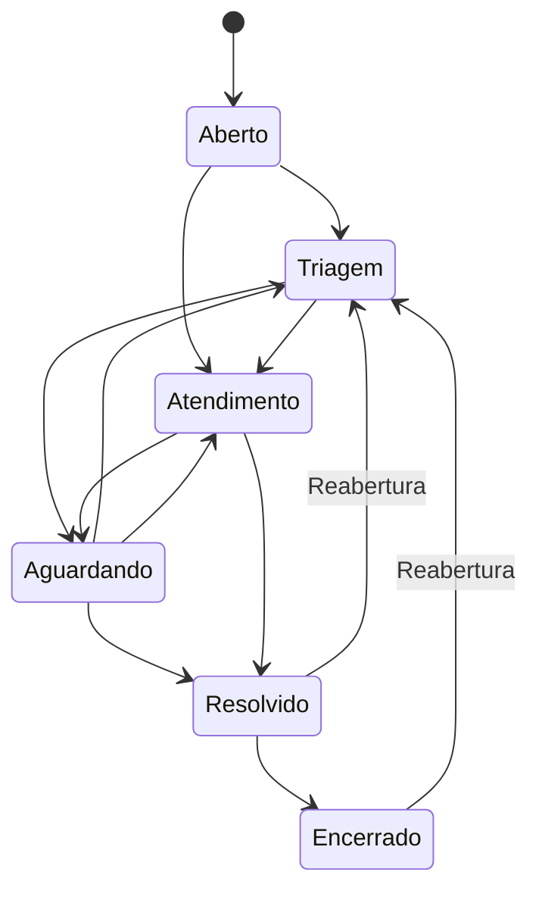

# Service Desk Municipal

Aplicação web de suporte de TI em **Python e Django**, baseada nos objetivos do TCC *Desenvolvimento e implementação de uma plataforma de Service Desk para gestão de incidentes de TI na administração pública municipal* (UNIP, 2026).

Esta primeira versão implementa o registro e o acompanhamento de incidentes e requisições, da abertura ao encerramento, com interface em português e API REST. As práticas de rastreabilidade, classificação e registro de atendimento se inspiram no contexto de ITIL e COBIT apresentado no trabalho; isso não representa certificação ou implementação integral desses frameworks.

## Executar localmente

Requisito: **Python 3.12**. SQLite é incluído no Python; não é necessário instalar Node.js ou um banco separado.

```bash
cd /workspace/TCC                  # ou o diretório em que você clonou o projeto
python -m venv .venv
source .venv/bin/activate          # Windows: .venv\Scripts\activate
python -m pip install -r requirements.txt
python manage.py migrate
python manage.py bootstrap_desk
python manage.py createsuperuser
python manage.py runserver 127.0.0.1:8000
```

Abra o endereço local informado pelo Django e entre com a conta criada. O repositório **não contém contas ou senhas padrão**. O comando `bootstrap_desk` pode ser executado novamente: ele mantém os registros e as configurações existentes.

As unidades iniciais são exemplos editáveis: Administração, Educação, Saúde, Finanças, Obras e Assistência Social. As categorias seguem o TCC: Hardware, Software, Conectividade, Impressoras, Telefonia e Criação de usuários.

Para acesso de outras máquinas da rede durante desenvolvimento, configure explicitamente os hosts autorizados e execute `runserver 0.0.0.0:8000`. O servidor de desenvolvimento não serve como implantação de produção.

## Perfis e criação de usuários

No menu **Administração → Usuários**, o superusuário pode criar contas e atribuir grupos:

| Perfil | Configuração | Acesso |
| --- | --- | --- |
| Solicitante | Usuário ativo, sem grupos de TI | Abre e acompanha apenas seus próprios chamados; envia mensagens, confirma a solução e reabre chamados. |
| Técnico | Grupo `Técnicos` | Consulta todos os chamados, classifica, assume/encaminha, atende, registra soluções e notas internas; consulta indicadores e exporta CSV. |
| Gestor | Grupo `Gestores` | Tem acesso ao atendimento completo; com **Membro da equipe** (`is_staff`), também administra categorias e unidades no Django Admin. |
| Administrador | Superusuário | Gerencia usuários, grupos, unidades e categorias e tem acesso a todos os chamados. |

No formulário de usuário, preencha nome, sobrenome e unidade no perfil. O atributo `is_staff` sozinho **não concede** o perfil de técnico. A criação e a concessão de acesso a usuários ficam com o superusuário; gestores não recebem permissão para promover contas.

Chamados e eventos ficam disponíveis para leitura no Admin. Alterações de atendimento são feitas pela aplicação/API para preservar as regras e o histórico. Prefira desativar categorias, unidades ou usuários que já tenham registros associados.

## Fluxo de atendimento



1. O servidor registra assunto, descrição, tipo, categoria, unidade, prioridade e patrimônio/equipamento opcional.
2. A TI faz a triagem e define um técnico ativo. O atendimento exige responsável.
3. Solicitante e TI conversam no chamado; apenas a TI vê e registra notas internas.
4. Para resolver, o técnico descreve a solução. Ela também fica registrada na conversa.
5. O solicitante confirma e encerra ou reabre, devolvendo à triagem. A TI também pode encerrar um chamado resolvido ou reabrir pelo formulário de atendimento.

Encerrados não recebem mensagens até serem reabertos. Registros de mudanças incluem autor e data. Formulários de classificação usam uma versão do chamado para impedir que uma edição antiga sobrescreva mudanças recentes.

## Painel e indicadores

- Chamados ativos, em atendimento, resolvidos/encerrados e críticos ativos.
- Aberturas por dia nos últimos sete dias e distribuição por categoria.
- Tempos médios da abertura à primeira resposta e da abertura à resolução, em **horas corridas**.
- Volume por unidade e identificação de equipamentos com solicitações recorrentes.
- Filtros por texto/protocolo/patrimônio, situação, prioridade, categoria, unidade e responsável atual.
- Exportação CSV dos chamados filtrados, disponível à TI, com proteção contra fórmulas de planilhas.

Primeira resposta: primeira mensagem pública de um profissional de TI diferente do solicitante, ou início do atendimento. Triagem, atribuição e notas internas não contam. Médias desconsideram registros sem o respectivo marco e mostram o tamanho da amostra. Ao reabrir, preserva-se a primeira resposta e limpa-se a data de resolução atual; quando o chamado for resolvido novamente, a duração será medida desde a abertura original. Soluções anteriores permanecem na conversa.

O painel do solicitante usa apenas seus registros. Os indicadores globais são exclusivos da TI. Os tempos não são um motor de SLA, não descontam finais de semana e não comprovam, isoladamente, redução de tempo no contexto da pesquisa.

## API REST

Autenticação de sessão do Django, com CSRF obrigatório para operações de escrita. É possível navegar pela API após entrar na aplicação, ou usar `/api-auth/login/`. Listagens são paginadas (20 itens). Os mesmos limites de acesso e regras da interface se aplicam à API.

| Método | Endpoint | Finalidade |
| --- | --- | --- |
| GET, POST | `/api/tickets/` | Listar os chamados permitidos / abrir um chamado |
| GET, PATCH | `/api/tickets/{id}/` | Consultar / atualizar classificação e atendimento (TI) |
| GET, POST | `/api/tickets/{id}/comments/` | Ler / enviar mensagens e notas internas autorizadas |
| GET | `/api/tickets/{id}/history/` | Ler histórico |
| POST | `/api/tickets/{id}/close/` | Solicitante confirma a solução |
| POST | `/api/tickets/{id}/reopen/` | Solicitante devolve à triagem |
| GET | `/api/categories/` | Categorias ativas |
| GET | `/api/departments/` | Unidades ativas |
| GET | `/api/metrics/` | Indicadores globais (TI) |

A listagem de chamados aceita `q`, `status`, `priority`, `category`, `department` e `mine=1`. Situações: `open`, `triage`, `in_progress`, `waiting`, `resolved`, `closed`; também existem os filtros `active` e `finished`. Prioridades: `low`, `medium`, `high`, `critical`. Tipos: `incident` e `request`.

Exemplo de corpo para abertura (substitua os IDs pelos cadastros do seu banco):

```json
{
  "title": "Impressora da recepção não imprime",
  "description": "O painel informa erro de papel desde o início do expediente.",
  "kind": "incident",
  "category": 1,
  "department": 1,
  "priority": "high",
  "equipment": "PAT-001"
}
```

Exemplo de atualização pela TI: `{"status": "in_progress", "assigned_to": 2, "version": 1}`. Use o `version` retornado pela leitura mais recente. Confirmar/reabrir também exige `{"version": 3}` com a versão atual. Em uma mensagem, `internal: true` é permitido apenas à TI. Não há endpoint de exclusão de chamados.

## Testar

```bash
python manage.py check
python manage.py makemigrations --check --dry-run
python manage.py test
```

Os testes usam banco isolado. Cobrem o ciclo completo, permissões entre usuários, histórico, notas internas, exigência de solução e responsável, reabertura, conflitos de versão, CSRF, escape de HTML, exportação CSV, métricas, API e repetibilidade dos cadastros iniciais.

## Estrutura

```text
config/             Configuração Django, rotas e pontos ASGI/WSGI
desk/models.py      Chamado, unidade, categoria, perfil, mensagens e eventos
desk/services.py    Regras de negócio e alterações transacionais
desk/permissions.py Escopo por perfil e propriedade do chamado
desk/views.py       Interface web, filtros e CSV
desk/api.py         Serializadores e endpoints REST
desk/metrics.py     Indicadores operacionais
desk/tests/         Testes funcionais web, API e regras de negócio
templates/          HTML renderizado pelo Django
static/desk/        CSS responsivo e JavaScript, sem dependência de CDN
docs/               Escopo e rastreabilidade dos requisitos do TCC
```

## Configuração e implantação

Os valores de desenvolvimento permitem execução local imediata. Consulte `.env.example`; ele documenta variáveis, **mas não é carregado automaticamente**. Defina variáveis pelo shell ou pelo gerenciador de processos.

| Variável | Uso |
| --- | --- |
| `DJANGO_DEBUG` | `1` no desenvolvimento; `0` na implantação. |
| `DJANGO_SECRET_KEY` | Chave privada obrigatória com `DEBUG=0`. |
| `DJANGO_ALLOWED_HOSTS` | Hosts explícitos separados por vírgula. |
| `DJANGO_DB_PATH` | Caminho opcional para o banco SQLite. |
| `DJANGO_CSRF_TRUSTED_ORIGINS` | Origens HTTPS adicionais autorizadas, separadas por vírgula. |
| `DJANGO_SECURE_COOKIES` | `1` ao servir por HTTPS. |

Antes de uso municipal real, configure servidor WSGI/ASGI com proxy HTTPS, desligue DEBUG, gere uma chave privada, restrinja os hosts e defina backup/restauração, retenção de dados e proteção contra tentativas de login. Execute `python manage.py collectstatic --noinput` e `python manage.py check --deploy` com as variáveis da implantação. SQLite é suficiente para este protótipo; adoção de PostgreSQL e testes de carga devem acompanhar a definição de volume/concorrência reais. A implantação definitiva não faz parte desta primeira versão.

Não registre senhas, documentos de cidadãos nem informações de pacientes nos chamados. A aplicação não depende de serviços externos durante o uso. Para instalar as dependências, utiliza `pypi.org` e `files.pythonhosted.org`.

## Próximas etapas

Validar os formulários e a matriz de prioridades com os servidores e técnicos; ajustar as unidades à prefeitura; testar com dados fictícios; definir metas de serviço. Funcionalidades ainda fora desta versão: anexos, notificações por e-mail, SLA por calendário útil, pesquisa de satisfação integrada, inventário completo de ativos e integração com diretórios institucionais. O questionário de satisfação do TCC pode permanecer externo, conforme o planejamento acadêmico.
